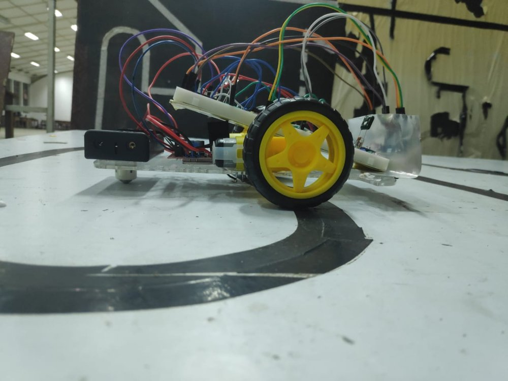
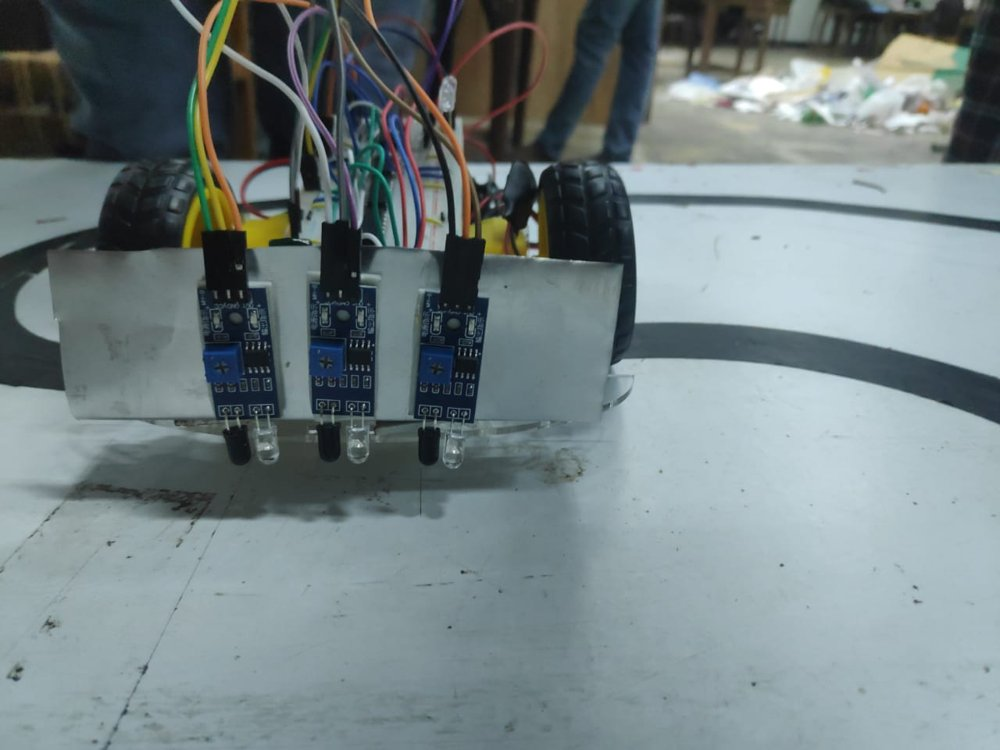
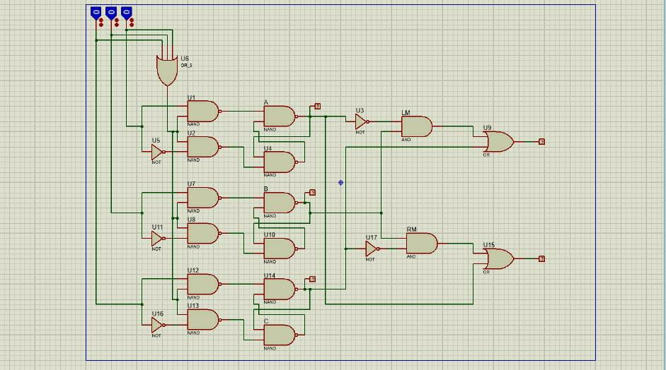

# Logic Bot: A Line Follower Without a Microcontroller

> A line-following robot whose "brain" is built only from logic gates and NAND-based D-latches: no microcontroller, no code. 🏆 **3rd place** in the class competition.

<p align="center">
  
  
</p>

**Course:** EE253 – Semester 3 Mini Project, University of Peradeniya · **Duration:** Dec 2024 – Apr 2025

**Team:** Harishraj T., Piranavini R., Kugaram M., Sanuri P., Kajanalini S.

**My role:** Logic circuit design and hardware implementation (with the team).

---

## The challenge
Follow a black line around a track using **only combinational and sequential logic**. Every decision a microcontroller would normally make in software had to be designed as a hardware circuit.

## How it works



### 1. Sensing
Three IR reflectance sensor modules (left **A**, centre **B**, right **C**) are mounted across the front of the chassis. Each gives a digital output: 1 when it is over the line.

### 2. Memory: holding the last position with D-latches
Each sensor feeds a **gated D-latch built from four NAND gates and an inverter** (U1/U2/A/U4, U7/U8/B/U10, U12/U13/U14/C). All three latches share one enable signal:

```
Enable = A_sensor OR B_sensor OR C_sensor        (U6, 3-input OR)
```

- **Any sensor on the line:** the latches are transparent and follow the sensors.
- **All sensors off the line:** the latches are disabled and **hold the last valid reading**. The robot keeps steering the way it was turning until it finds the line again.

This handles sharp curves where the robot overshoots the line, which a purely combinational design can't do.

### 3. Steering logic
The latched values A, B and C drive the two motor enables:

```
Left motor  = (¬A · B) + C        (U3 NOT, LM AND, U9 OR)
Right motor = (B · ¬C) + A        (U17 NOT, RM AND, U15 OR)
```

| A (left) | B (centre) | C (right) | Left motor | Right motor | Action |
|:-:|:-:|:-:|:-:|:-:|---|
| 0 | 1 | 0 | ON | ON | ⬆️ Forward |
| 1 | 0 | 0 | off | ON | ↰ Turn left |
| 1 | 1 | 0 | off | ON | ↰ Turn left |
| 0 | 0 | 1 | ON | off | ↱ Turn right |
| 0 | 1 | 1 | ON | off | ↱ Turn right |
| 1 | 1 | 1 | ON | ON | ⬆️ Forward (junction or wide line) |
| 1 | 0 | 1 | ON | ON | ⬆️ Forward |
| 0 | 0 | 0 | *held* | *held* | 🔁 Latches keep the last state |

### 4. Drive
The motor-enable signals switch a motor driver module that runs two geared DC motors (differential drive), with a castor wheel at the back. A **555 timer** provided the timing and synchronization signal *(edit this to say exactly how it was used)*.

## Hardware
| Part | Purpose |
|---|---|
| 3 × IR reflectance sensor modules | Line detection (adjustable threshold) |
| NAND / NOT / AND / OR logic ICs | D-latches and steering logic |
| 555 timer | Timing and synchronization |
| Motor driver module + 2 × geared DC motors | Differential drive |
| Acrylic chassis, castor, battery pack | Platform and power |

## Challenges & what I learned
- **Losing the line on sharp turns:** a purely combinational controller stops or goes straight when every sensor leaves the line. → Added **D-latches gated by OR(sensors)** to remember the last direction.
- **Hardware timing and troubleshooting:** a gate-level circuit on breadboards has many failure points (loose wires, floating inputs, sensor threshold drift). → Debugged stage by stage: sensors → latches → steering logic → motors.
- **Sensor calibration:** each module's potentiometer had to be tuned to the track surface and lighting so the black/white threshold was reliable.

## Result
Completed the competition track and placed **3rd in the class**.

## Repository contents
```
├── hardware/logic_bot_proteus.pdsprj   # Proteus simulation of the latch + steering logic
├── hardware/schematic.jpg
└── media/                              # robot photos
```

## Simulate
Open `hardware/logic_bot_proteus.pdsprj` in Proteus. Toggle the three logic-state inputs (sensors) and watch the latch outputs and the two motor outputs. Set all three to 0 to see the latches hold the last state.

## Acknowledgements
Teammates Piranavini R., Kugaram M., Sanuri P. and Kajanalini S., and the EE253 course staff, peers and seniors, Department of EEE, University of Peradeniya.
